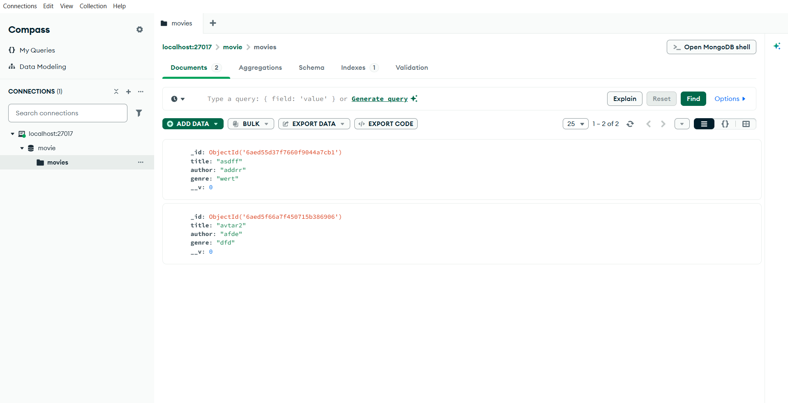
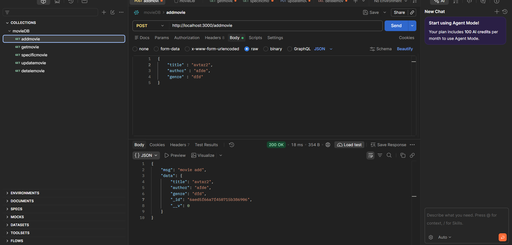
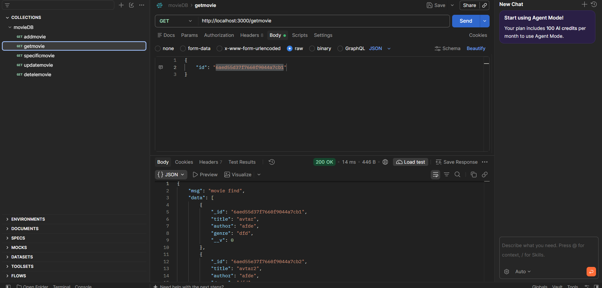
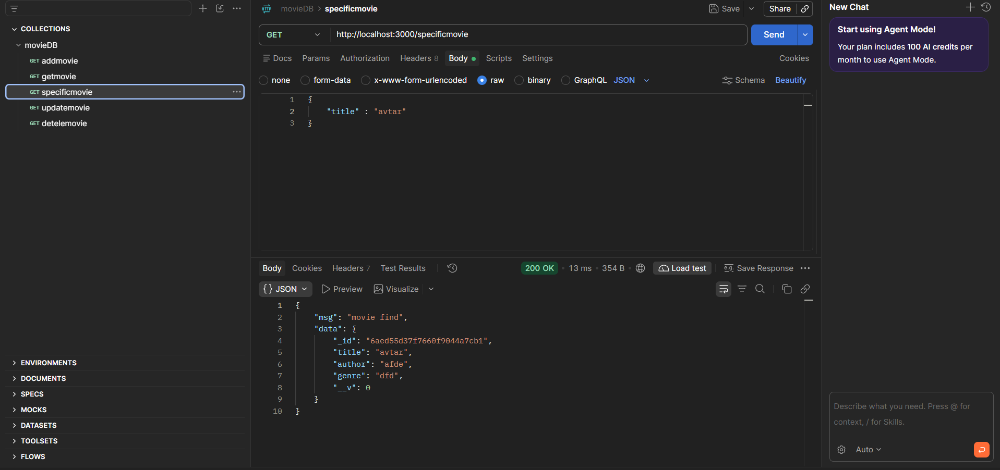
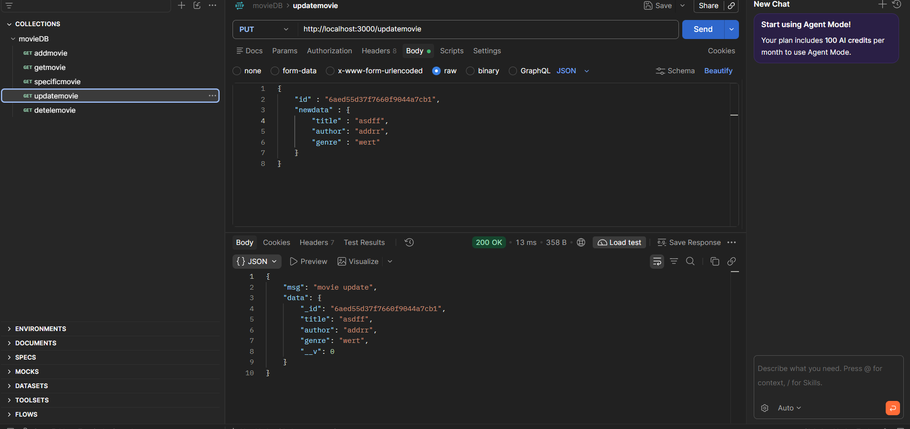
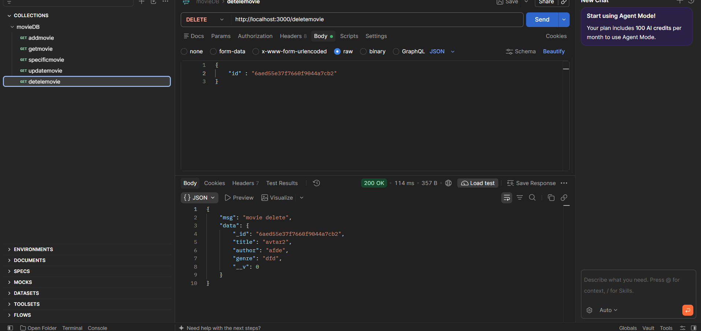

# 🎬 Movie CRUD Project

## 📌 About Project

Movie Management API is a RESTful backend application built using **Node.js, Express.js, MongoDB, and Mongoose**.

This application allows users to perform CRUD (Create, Read, Update, Delete) operations to manage movie records efficiently.

## 🚀 Features

- ➕ Add New Movie
- 📋 Get All Movies
- 🔍 Get Movie by ID
- ✏️ Update Movie Details
- 🗑️ Delete Movie
- 🗄️ MongoDB Database Connectivity
- ⚡ RESTful API Architecture

## 🛠️ Technologies Used

- 🟢 Node.js
- 🚂 Express.js
- 🍃 MongoDB
- 📦 Mongoose
- 💻 JavaScript
- 🔧 Postman (API Testing)

## 📁 Project Structure

```

MovieProject/
│
├── node_modules/
│
├── screenshots/
│   ├── addmovie.png
│   ├── deletemovie.png
│   ├── getmovie.png
│   ├── movie.png
│   ├── specificmovie.png
│   └── updatemovie.png
│
├── app.js
│
├── package-lock.json
│
├── package.json
│
└── README.md

```

*Note: Update the folder structure according to your actual project files.*

## ⚙️ Installation & Setup

### 1. Clone Repository

```bash
git clone YOUR_GITHUB_REPOSITORY_URL
```

### 2. Open Project Folder

```bash
cd Movie-CRUD
```

### 3. Install Dependencies

```bash
npm install
```

### 4. Configure MongoDB

Add your MongoDB connection string in the environment configuration.

Create a `.env` file:

```env
PORT=3000
MONGO_URI=your_mongodb_connection_string
```

### 5. Start Server

```bash
npm start
```


### ➕ Add Movie

**POST** `/addmovie`

Request Body:

```json
{
  "name": "Inception",
  "director": "Christopher Nolan",
  "releaseYear": 2010,
  "genre": "Sci-Fi",
  "rating": 8.8
}
```

## 🖼️ Screenshots

### 1. Movie Management API


### 2. Add Movie


### 3. Get All Movies


### 4. Get Specific Movie


### 5. Update Movie


### 6. Delete Movie


## 👨‍💻 Author

** ALPESH SARVAIYA ❤️‍🩹 **
"# Movie-Crud" 
